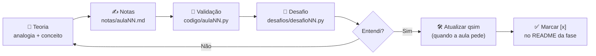
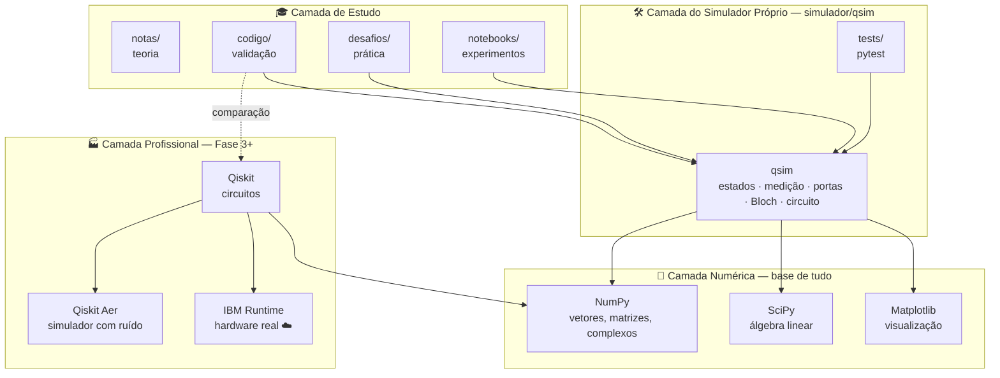
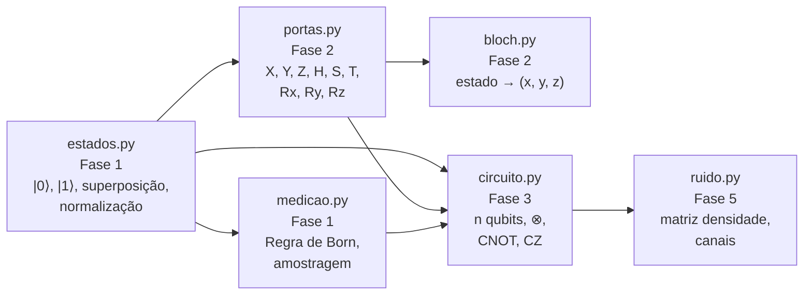
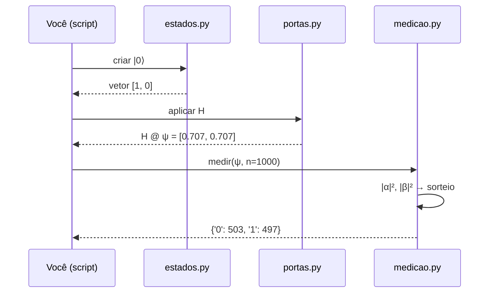

# ⚛️ Computação Quântica — do zero ao avançado

> Plano de estudos de **Python + Computação Quântica** com foco em teoria,
> validada passo a passo por simulações em Python. Ao longo do curso, você
> constrói o seu próprio simulador quântico (`qsim`) e o compara com o
> **Qiskit**, um framework profissional.

---

## 📑 Sumário

1. [Visão geral](#1-visão-geral)
2. [Pré-requisitos](#2-pré-requisitos)
3. [Instalação passo a passo (Linux, macOS e Windows)](#3-instalação-passo-a-passo)
4. [Como seguir o plano de estudos](#4-como-seguir-o-plano-de-estudos)
5. [Arquitetura do sistema](#5-arquitetura-do-sistema)
6. [Estrutura de pastas](#6-estrutura-de-pastas)
7. [Cronograma completo](#7-cronograma-completo)
8. [Comandos do dia a dia](#8-comandos-do-dia-a-dia)
9. [Solução de problemas](#9-solução-de-problemas)
10. [Referências](#10-referências)

---

## 1. Visão geral

O projeto tem **três frentes** que avançam juntas:

| Frente | O que é | Onde fica |
|---|---|---|
| 📖 **Teoria** | Conceitos físicos e matemáticos, com analogias do dia a dia | `fases/*/notas/` |
| 🧪 **Validação** | Scripts curtos que "provam" cada conceito com código | `fases/*/codigo/` e `fases/*/desafios/` |
| 🛠️ **Projeto contínuo** | Um mini-simulador quântico que cresce a cada fase | `simulador/qsim/` |

**Analogia:** as `notas/` são o caderno de teoria, o `codigo/` é o laboratório
onde você testa o que aprendeu, e o `simulador/` é o equipamento que você vai
construindo ao longo do curso. No fim, você terá feito do zero algo parecido
com o que o Qiskit faz por dentro.

---

## 2. Pré-requisitos

| Item | Versão | Obrigatório? |
|---|---|---|
| **Python** | 3.10 ou superior (recomendado **3.12**) | ✅ Sim |
| **pip** | vem junto com o Python | ✅ Sim |
| **Editor de código** | [VS Code](https://code.visualstudio.com) (recomendado) | ✅ Sim |
| **Git** | qualquer versão recente | ⭕ Opcional (para versionar o progresso) |
| **Conta IBM Quantum** | gratuita | ⭕ Só na Fase 4 (hardware real) |

> 💡 **Não quer instalar nada?** Dá para seguir as Fases 0 a 2 no
> [Google Colab](https://colab.research.google.com), direto no navegador.
> A partir da Fase 3, o ideal é ter o ambiente local.

---

## 3. Instalação passo a passo

Em todos os sistemas, o caminho é o mesmo:

```
Instalar Python  →  Abrir terminal na pasta  →  Criar ambiente virtual
       →  Ativar ambiente  →  Instalar dependências  →  Testar
```

### 3.1 Instalar o Python

<details>
<summary>🐧 <b>Linux</b> (Ubuntu / Debian / Mint)</summary>

Quase sempre o Python já vem instalado. Confira e instale o que faltar:

```bash
python3 --version
sudo apt update
sudo apt install python3 python3-venv python3-pip
```

No **Fedora**: `sudo dnf install python3 python3-pip`
No **Arch**: `sudo pacman -S python python-pip`
</details>

<details>
<summary>🍎 <b>macOS</b></summary>

Opção 1 (recomendada), com [Homebrew](https://brew.sh):

```bash
brew install python@3.12
python3 --version
```

Opção 2: baixar o instalador em <https://www.python.org/downloads/>.
</details>

<details>
<summary>🪟 <b>Windows</b></summary>

1. Baixe o instalador em <https://www.python.org/downloads/>.
2. ⚠️ **Na primeira tela, marque a caixa _"Add python.exe to PATH"_.**
3. Clique em *Install Now*.
4. Abra o **PowerShell** e confira:

```powershell
py --version
```
</details>

### 3.2 Baixar o projeto e abrir o terminal na pasta

Clone o repositório (o comando é igual em todos os sistemas):

```bash
git clone https://github.com/TiagoRodriguesskt/Quantum-Computing.git
cd Quantum-Computing
```

> Sem Git? No GitHub, clique em **Code → Download ZIP** e extraia a pasta.

Se você já tem a pasta no computador, basta abrir o terminal nela:

| Sistema | Como fazer |
|---|---|
| Linux / macOS | `cd caminho/da/pasta` (ex.: `cd ~/Estudos/Computação-Quântica`) |
| Windows | Abra a pasta no Explorador → clique na barra de endereço → digite `powershell` → Enter |
| VS Code (qualquer SO) | *Arquivo → Abrir Pasta* → depois *Terminal → Novo Terminal* |

### 3.3 Criar o ambiente virtual

O **ambiente virtual** (`.venv`) é uma "caixa isolada" com as bibliotecas
deste projeto. **Analogia:** é como ter um estojo só para as aulas de física.
O que você coloca nele não se mistura com o resto do computador.

| Sistema | Comando |
|---|---|
| Linux / macOS | `python3 -m venv .venv` |
| Windows | `py -m venv .venv` |

> Esse passo só é feito **uma vez**.

### 3.4 Ativar o ambiente virtual

| Sistema | Terminal | Comando |
|---|---|---|
| Linux / macOS | bash / zsh | `source .venv/bin/activate` |
| Windows | PowerShell | `.venv\Scripts\Activate.ps1` |
| Windows | CMD | `.venv\Scripts\activate.bat` |

Quando der certo, aparece `(.venv)` no início da linha do terminal:

```
(.venv) tiago@pc:~/Estudos/Computação-Quântica$
```

> ⚠️ Você precisa **ativar** o ambiente **toda vez** que abrir um terminal novo.

### 3.5 Instalar as dependências

Com o ambiente ativado (o comando é igual em todos os sistemas):

```bash
python -m pip install --upgrade pip
pip install -r requirements.txt
```

O que será instalado:

| Pacote | Para que serve | Usado a partir de |
|---|---|---|
| `numpy` | Vetores, matrizes e números complexos | Fase 0 |
| `scipy` | Álgebra linear avançada | Fase 2 |
| `matplotlib` | Gráficos, histogramas, Esfera de Bloch | Fase 0 |
| `jupyterlab`, `ipykernel` | Notebooks interativos | Fase 0 |
| `qiskit` | Montar circuitos quânticos | Fase 3 |
| `qiskit-aer` | Simulador rápido, com ruído | Fase 3 |
| `qiskit-ibm-runtime` | Rodar em computadores quânticos reais | Fase 4 |
| `pylatexenc` | Desenhar circuitos bonitos (`draw("mpl")`) | Fase 3 |
| `pytest` | Testes automáticos do simulador | Fase 1 |

### 3.6 Testar a instalação

```bash
python -c "import numpy, qiskit; print('numpy', numpy.__version__, '| qiskit', qiskit.__version__)"
pytest simulador/tests
```

✅ **Tudo certo** se aparecer algo como:

```
numpy 2.x.x | qiskit 2.x.x
1 passed
```

### 3.7 (Opcional) Registrar o ambiente no Jupyter

Assim o Jupyter e o VS Code reconhecem o ambiente pelo nome:

```bash
python -m ipykernel install --user --name computacao-quantica --display-name "Computação Quântica"
```

---

## 4. Como seguir o plano de estudos

### 4.1 O ciclo de cada aula

Toda aula segue o mesmo fluxo:



1. **Teoria:** estude o conceito (analogia → definição → exemplo em contas).
2. **Notas:** escreva um resumo com **suas palavras** em `notas/`.
3. **Validação:** rode o script da aula e confira se o resultado bate com a teoria.
4. **Desafio:** resolva o desafio proposto, sozinho, em `desafios/`.
5. **Simulador:** quando a aula fecha um marco, adicione a peça ao `qsim`.
6. **Progresso:** marque a aula como concluída no `README.md` da fase (`- [ ]` → `- [x]`).

### 4.2 Convenção de nomes

O número da aula vai sempre na frente, com dois dígitos, para manter os arquivos em ordem:

| Tipo | Padrão | Exemplo |
|---|---|---|
| Nota teórica | `aulaNN_tema.md` | `aula05_portas_pauli.md` |
| Script da aula | `aulaNN_tema.py` | `aula05_portas_pauli.py` |
| Desafio | `desafioNN_tema.py` | `desafio05_unitariedade.py` |
| Notebook livre | `NN_tema.ipynb` | `05_explorando_hadamard.ipynb` |

> Use **letras minúsculas**, **sem acentos** e **sem espaços** (use `_`).
> Isso evita erros de `import` no Python e problemas entre sistemas operacionais.

### 4.3 Rodando um script

```bash
# sempre a partir da raiz do projeto, com o .venv ativado
python fases/fase1_fundamentos/codigo/aula04_medicao.py
```

### 4.4 Rodando um notebook

```bash
jupyter lab
```

O navegador abre sozinho. Crie seus notebooks dentro da pasta `notebooks/`.

---

## 5. Arquitetura do sistema

### 5.1 Visão em camadas

O projeto é organizado em **camadas**. Cada camada usa a de baixo:



| Camada | Papel | Analogia |
|---|---|---|
| 🔢 **Numérica** | Faz as contas: estados são vetores, portas são matrizes | A calculadora |
| 🛠️ **Simulador próprio** | Implementa a mecânica quântica **à mão**, usando NumPy | O motor que você monta peça por peça |
| 🏭 **Profissional** | Ferramentas da indústria, para comparar e ir além | O carro de fábrica, para comparar com o seu |
| 🎓 **Estudo** | Onde você aprende, testa e pratica | O caderno e a bancada de laboratório |

A ideia principal: **primeiro você constrói (qsim), depois usa a ferramenta
pronta (Qiskit)**. Assim o Qiskit nunca vira uma "caixa-preta".

### 5.2 Arquitetura interna do `qsim`

Os módulos do simulador são criados ao longo do curso. As setas mostram quem
depende de quem:



### 5.3 Fluxo de uma simulação

O que acontece "por baixo dos panos" quando você simula um circuito:



### 5.4 Marcos do simulador por fase

| Fase | O que o `qsim` passa a fazer |
|---|---|
| 1 | Criar estados, normalizar e medir (Regra de Born) |
| 2 | Aplicar portas de 1 qubit e plotar na Esfera de Bloch |
| 3 | Suportar n qubits (produto tensorial, CNOT) e comparar com o Qiskit |
| 4 | Rodar Deutsch-Jozsa e Grover no próprio simulador |
| 5 | Simular ruído com matriz densidade |

---

## 6. Estrutura de pastas

```
Quantum-Computing/
│
├── README.md                    ← 📘 esta documentação
├── requirements.txt             ← 📦 dependências (pip install -r requirements.txt)
├── .gitignore                   ← 🚫 arquivos que o Git deve ignorar
├── .venv/                       ← 🧰 ambiente virtual (criado por você, não versionar)
│
├── fases/                       ← 🎓 o curso, uma pasta por fase
│   ├── fase0_python/            ← Python do zero (P1–P7)
│   │   ├── README.md            ←   lista de aulas com checklist [ ]
│   │   ├── notas/               ←   resumos teóricos (.md)
│   │   ├── codigo/              ←   scripts de validação (.py)
│   │   └── desafios/            ←   suas soluções (.py)
│   ├── fase1_fundamentos/       ← Matemática base, qubit, Dirac, medição (0–4)
│   ├── fase2_um_qubit/          ← Portas, Esfera de Bloch, interferência (5–7)
│   ├── fase3_multiplos_qubits/  ← Produto tensorial, CNOT, emaranhamento (8–10.5)
│   ├── fase4_algoritmos/        ← Protocolos, algoritmos, hardware NISQ (11–14)
│   └── fase5_avancado/          ← Matriz densidade, QEC, VQE, projeto final (15–20)
│       (todas as fases têm a mesma estrutura: README.md, notas/, codigo/, desafios/)
│
├── simulador/                   ← 🛠️ projeto contínuo
│   ├── README.md                ←   marcos do simulador
│   ├── qsim/                    ←   pacote Python
│   │   └── __init__.py          ←   (módulos novos entram aqui a cada fase)
│   └── tests/                   ←   testes automáticos
│       └── test_versao.py
│
├── notebooks/                   ← 📓 experimentos livres no Jupyter
└── recursos/                    ← 📚 livros, artigos e links
    └── README.md
```

> Os arquivos `.gitkeep` dentro das pastas vazias só servem para o Git
> registrar essas pastas. Pode ignorá-los.

---

## 7. Cronograma completo

| Fase | Tema | Aulas | Marco do projeto |
|---|---|---|---|
| **0** | Python do zero | P1–P7 | Dominar NumPy e Matplotlib |
| **1** | Fundamentos e matemática base | 0–4 | `qsim` cria e mede estados |
| **2** | Manipulando um qubit | 5–7 | `qsim` aplica portas e plota a Esfera de Bloch |
| **3** | Vários qubits e emaranhamento | 8–10.5 | `qsim` com n qubits + introdução ao Qiskit |
| **4** | Protocolos, algoritmos e NISQ | 11–14 | Circuito rodando em um computador quântico real |
| **5** | Avançado | 15–20 | Projeto final (VQE / sistema físico) |

A lista detalhada de cada aula está no `README.md` de cada fase.

---

## 8. Comandos do dia a dia

| Tarefa | Linux / macOS | Windows (PowerShell) |
|---|---|---|
| Ativar o ambiente | `source .venv/bin/activate` | `.venv\Scripts\Activate.ps1` |
| Desativar o ambiente | `deactivate` | `deactivate` |
| Rodar um script | `python caminho/arquivo.py` | `python caminho\arquivo.py` |
| Abrir o Jupyter | `jupyter lab` | `jupyter lab` |
| Rodar os testes | `pytest simulador/tests` | `pytest simulador\tests` |
| Ver os pacotes instalados | `pip list` | `pip list` |
| Reinstalar as dependências | `pip install -r requirements.txt` | `pip install -r requirements.txt` |

### Salvando o progresso no GitHub

```bash
git add .
git commit -m "Aula 05: portas de Pauli"
git push
```

Um commit por aula vira um **diário do seu progresso**.

---

## 9. Solução de problemas

| Problema | Causa provável | Solução |
|---|---|---|
| `python: command not found` (Linux/macOS) | O comando no seu sistema é `python3` | Use `python3`, ou ative o `.venv` (lá dentro, `python` funciona) |
| `'python' não é reconhecido` (Windows) | O Python não foi adicionado ao PATH | Use `py`, ou reinstale marcando *"Add python.exe to PATH"* |
| `Activate.ps1 não pode ser carregado` (Windows) | Política de segurança do PowerShell | Rode uma vez: `Set-ExecutionPolicy -Scope CurrentUser RemoteSigned` |
| `ensurepip is not available` (Ubuntu/Debian) | Falta o pacote `venv` | `sudo apt install python3-venv` |
| `ModuleNotFoundError: No module named 'numpy'` | O `.venv` não está ativado | Ative o ambiente (seção 3.4) e rode de novo |
| `error: externally-managed-environment` | Tentou instalar fora do `.venv` | Ative o `.venv` antes do `pip install` |
| O VS Code não acha as bibliotecas | O VS Code está usando outro Python | `Ctrl+Shift+P` → *Python: Select Interpreter* → escolha `.venv` |
| `qc.draw("mpl")` dá erro | Falta o `pylatexenc` | `pip install pylatexenc` |
| A instalação do Qiskit falha | Versão do Python antiga | Confira com `python --version` (precisa ser 3.10+) |

---

## 10. Referências

Veja a lista completa em [`recursos/README.md`](recursos/README.md). Os principais:

- **Nielsen & Chuang**, *Quantum Computation and Quantum Information*, a principal referência da área.
- **IBM Quantum Learning**: <https://learning.quantum.ibm.com>
- **Documentação do Qiskit**: <https://docs.quantum.ibm.com>
- **Documentação do NumPy**: <https://numpy.org/doc>

---

<p align="center"><i>Teoria primeiro, código como prova. ⚛️</i></p>
