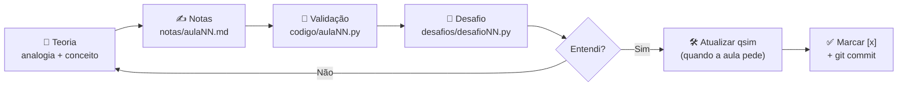
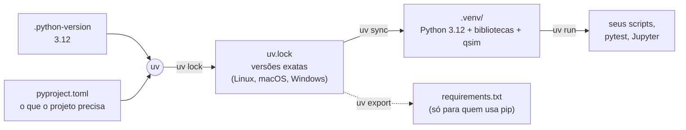
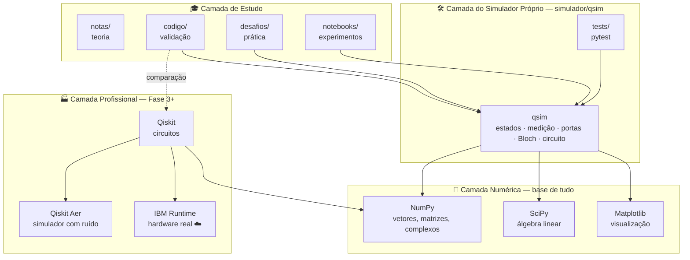
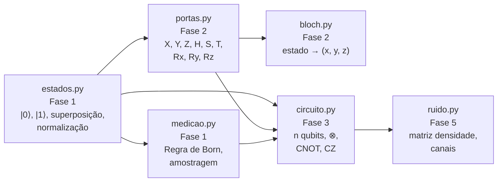
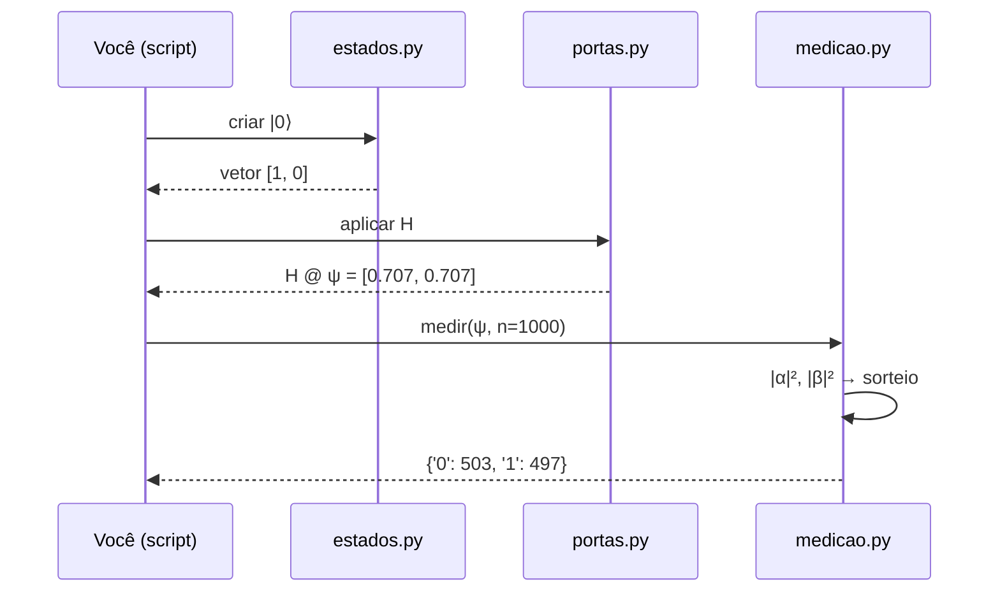

# ⚛️ Computação Quântica — do zero ao avançado

> Plano de estudos de **Python + Computação Quântica** com foco em teoria,
> validada passo a passo por simulações em Python. Ao longo do curso, você
> constrói o seu próprio simulador quântico (`qsim`) e o compara com o
> **Qiskit**, um framework profissional.
>
> O ambiente é gerenciado pelo **[uv](https://docs.astral.sh/uv/)**: um único
> comando (`uv sync`) instala o Python certo e todas as bibliotecas, nas
> mesmas versões, em Linux, macOS ou Windows.

---

## 📑 Sumário

1. [Visão geral](#1-visão-geral)
2. [Pré-requisitos](#2-pré-requisitos)
3. [Instalação passo a passo (Linux, macOS e Windows)](#3-instalação-passo-a-passo)
4. [Como seguir o plano de estudos](#4-como-seguir-o-plano-de-estudos)
5. [Arquitetura do sistema](#5-arquitetura-do-sistema)
6. [Estrutura de pastas](#6-estrutura-de-pastas)
7. [Cronograma completo](#7-cronograma-completo)
8. [Comandos do dia a dia](#8-comandos-do-dia-a-dia)
9. [Solução de problemas](#9-solução-de-problemas)
10. [Alternativa sem uv (pip)](#10-alternativa-sem-uv-pip)
11. [Referências](#11-referências)

---

## 1. Visão geral

O projeto tem **três frentes** que avançam juntas:

| Frente | O que é | Onde fica |
|---|---|---|
| 📖 **Teoria** | Conceitos físicos e matemáticos, com analogias do dia a dia | `fases/*/notas/` |
| 🧪 **Validação** | Scripts curtos que "provam" cada conceito com código | `fases/*/codigo/` e `fases/*/desafios/` |
| 🛠️ **Projeto contínuo** | Um mini-simulador quântico que cresce a cada fase | `simulador/qsim/` |

**Analogia:** as `notas/` são o caderno de teoria, o `codigo/` é o laboratório
onde você testa o que aprendeu, e o `simulador/` é o equipamento que você vai
construindo ao longo do curso. No fim, você terá feito do zero algo parecido
com o que o Qiskit faz por dentro.

---

## 2. Pré-requisitos

| Item | Obrigatório? | Observação |
|---|---|---|
| **uv** | ✅ Sim | Gerencia o Python, o ambiente virtual e as bibliotecas |
| **Git** | ✅ Sim | Para baixar o projeto e salvar o progresso |
| **Editor de código** | ✅ Sim | [VS Code](https://code.visualstudio.com) recomendado |
| **Python** | ❌ Não precisa instalar | O uv baixa o Python 3.12 sozinho (versão fixada em `.python-version`) |
| **Conta IBM Quantum** | ⭕ Só na Fase 4 | Gratuita, para rodar em hardware real |

> 💡 **Por que uv?** Ele substitui `pip`, `venv` e `pyenv` em uma ferramenta só,
> é muito mais rápido e grava as versões exatas de tudo no `uv.lock`.
> **Analogia:** o `pip` recebe uma lista de compras ("pelo menos 1 kg de
> arroz"); o `uv.lock` é a **nota fiscal**, com marca, peso e lote. Com ela,
> qualquer pessoa reproduz exatamente a mesma compra.

---

## 3. Instalação passo a passo

Em todos os sistemas, o caminho é o mesmo:

```
Instalar uv  →  Clonar o projeto  →  uv sync  →  Testar
```

### 3.1 Instalar o uv

<details open>
<summary>🐧 <b>Linux</b> (Debian, Ubuntu, Fedora, Arch...)</summary>

```bash
curl -LsSf https://astral.sh/uv/install.sh | sh
```

Feche e abra o terminal (ou rode `source ~/.local/bin/env`) e confira:

```bash
uv --version
```

> Sem `curl`? No Debian/Ubuntu: `sudo apt install curl`.
</details>

<details>
<summary>🍎 <b>macOS</b></summary>

```bash
curl -LsSf https://astral.sh/uv/install.sh | sh
# ou, com Homebrew:
brew install uv
```

```bash
uv --version
```
</details>

<details>
<summary>🪟 <b>Windows</b></summary>

No **PowerShell**:

```powershell
powershell -ExecutionPolicy ByPass -c "irm https://astral.sh/uv/install.ps1 | iex"
# ou, com winget:
winget install --id=astral-sh.uv -e
```

Feche e abra o PowerShell e confira:

```powershell
uv --version
```
</details>

### 3.2 Baixar o projeto

```bash
git clone https://github.com/TiagoRodriguesskt/Quantum-Computing.git
cd Quantum-Computing
```

> Sem Git? No GitHub, clique em **Code → Download ZIP**, extraia a pasta e
> abra o terminal dentro dela.

### 3.3 Instalar tudo com um comando

```bash
uv sync
```

Esse comando, sozinho:

1. lê o `.python-version` e **baixa o Python 3.12** se ele não estiver instalado;
2. cria o ambiente virtual `.venv/` dentro do projeto;
3. instala **as versões exatas** de todas as bibliotecas registradas no `uv.lock`;
4. instala o seu simulador `qsim` como pacote (em modo editável).

**Analogia do ambiente virtual:** o `.venv` é um "estojo" só para este projeto.
O que você coloca nele não se mistura com o resto do computador.

O que é instalado:

| Pacote | Para que serve | Usado a partir de | Grupo |
|---|---|---|---|
| `numpy` | Vetores, matrizes e números complexos | Fase 0 | principal |
| `scipy` | Álgebra linear avançada | Fase 2 | principal |
| `matplotlib` | Gráficos, histogramas, Esfera de Bloch | Fase 0 | principal |
| `qiskit` | Montar circuitos quânticos | Fase 3 | principal |
| `qiskit-aer` | Simulador rápido, com ruído | Fase 3 | principal |
| `qiskit-ibm-runtime` | Rodar em computadores quânticos reais | Fase 4 | principal |
| `pylatexenc` | Desenhar circuitos (`draw("mpl")`) | Fase 3 | principal |
| `jupyterlab`, `ipykernel` | Notebooks interativos | Fase 0 | `dev` |
| `pytest` | Testes automáticos do simulador | Fase 1 | `dev` |
| `qsim` | **Seu simulador** (pasta `simulador/qsim`) | Fase 1 | o próprio projeto |

### 3.4 Testar a instalação

```bash
uv run python scripts/verificar_ambiente.py
uv run pytest
```

✅ **Tudo certo** se aparecer:

```
✅ Ambiente pronto! Pode começar a Aula P1.
...
1 passed
```

### 3.5 Por que `uv run` e não `python`?

`uv run <comando>` executa o comando **dentro do ambiente do projeto**, sem
precisar ativar nada. E, antes de rodar, ele confere se o ambiente está em
dia com o `pyproject.toml`; se não estiver, sincroniza sozinho.

| Em vez de... | Use |
|---|---|
| `python arquivo.py` | `uv run python arquivo.py` |
| `pytest` | `uv run pytest` |
| `jupyter lab` | `uv run jupyter lab` |

> Prefere ativar o ambiente do jeito tradicional? Também funciona:
> `source .venv/bin/activate` (Linux/macOS) ou `.venv\Scripts\Activate.ps1`
> (Windows). Depois disso, `python` e `pytest` funcionam direto.

### 3.6 (Opcional) Usar o ambiente no VS Code e no Jupyter

- **VS Code:** `Ctrl+Shift+P` → *Python: Select Interpreter* → escolha `.venv`.
- **Jupyter:** registre o ambiente com um nome amigável:

```bash
uv run python -m ipykernel install --user --name computacao-quantica --display-name "Computação Quântica"
```

---

## 4. Como seguir o plano de estudos

### 4.1 O ciclo de cada aula

Toda aula segue o mesmo fluxo:



1. **Teoria:** estude o conceito (analogia → definição → exemplo em contas).
2. **Notas:** escreva um resumo com **suas palavras** em `notas/`.
3. **Validação:** rode o script da aula e confira se o resultado bate com a teoria.
4. **Desafio:** resolva o desafio proposto, sozinho, em `desafios/`.
5. **Simulador:** quando a aula fecha um marco, adicione a peça ao `qsim` e rode `uv run pytest`.
6. **Progresso:** marque a aula no `README.md` da fase (`- [ ]` → `- [x]`) e faça um commit.

### 4.2 Convenção de nomes

| Tipo | Padrão | Exemplo |
|---|---|---|
| Nota teórica | `aulaNN_tema.md` | `aula05_portas_pauli.md` |
| Script da aula | `aulaNN_tema.py` | `aula05_portas_pauli.py` |
| Desafio | `desafioNN_tema.py` | `desafio05_unitariedade.py` |
| Aulas de Python (Fase 0) | `P` no lugar de `NN` | `desafioP1_meio_somador.py` |
| Notebook livre | `NN_tema.ipynb` | `05_explorando_hadamard.ipynb` |

> Use **letras minúsculas**, **sem acentos** e **sem espaços** (use `_`).
> Isso evita erros de `import` no Python e problemas entre sistemas operacionais.

### 4.3 Rodando um script

```bash
# sempre a partir da raiz do projeto
uv run python fases/fase1_fundamentos/codigo/aula04_medicao.py
```

Como o `qsim` é um pacote instalado, **qualquer script** pode usá-lo:

```python
import qsim
```

### 4.4 Modo interativo e notebooks

```bash
uv run python        # modo interativo (>>>), ótimo para testar ideias
uv run jupyter lab   # abre o Jupyter no navegador
```

Crie seus notebooks dentro da pasta `notebooks/`.

---

## 5. Arquitetura do sistema

### 5.1 As ferramentas: como o uv organiza o ambiente



| Arquivo | Quem escreve | Vai para o GitHub? | Papel |
|---|---|---|---|
| `pyproject.toml` | Você (ou `uv add`) | ✅ Sim | O que o projeto **precisa** (ex.: `numpy>=2.0`) |
| `.python-version` | Você | ✅ Sim | Qual Python usar |
| `uv.lock` | O uv, automaticamente | ✅ **Sim, sempre** | O que foi **instalado de fato** (ex.: `numpy==2.5.4`) |
| `.venv/` | O uv, automaticamente | ❌ Não | O ambiente em si; recriado com `uv sync` |
| `requirements.txt` | `uv export` | ✅ Sim | Compatibilidade com pip |

> **Regra de ouro:** nunca edite o `uv.lock` à mão e nunca instale pacotes com
> `pip install` dentro do projeto. Use sempre `uv add` / `uv remove`.

### 5.2 Visão em camadas do código

O projeto é organizado em **camadas**. Cada camada usa a de baixo:



| Camada | Papel | Analogia |
|---|---|---|
| 🔢 **Numérica** | Faz as contas: estados são vetores, portas são matrizes | A calculadora |
| 🛠️ **Simulador próprio** | Implementa a mecânica quântica **à mão**, usando NumPy | O motor que você monta peça por peça |
| 🏭 **Profissional** | Ferramentas da indústria, para comparar e ir além | O carro de fábrica, para comparar com o seu |
| 🎓 **Estudo** | Onde você aprende, testa e pratica | O caderno e a bancada de laboratório |

A ideia principal: **primeiro você constrói (qsim), depois usa a ferramenta
pronta (Qiskit)**. Assim o Qiskit nunca vira uma "caixa-preta".

### 5.3 Arquitetura interna do `qsim`

Os módulos do simulador são criados ao longo do curso. As setas mostram quem
depende de quem:



### 5.4 Fluxo de uma simulação

O que acontece "por baixo dos panos" quando você simula um circuito:



### 5.5 Marcos do simulador por fase

| Fase | O que o `qsim` passa a fazer |
|---|---|
| 1 | Criar estados, normalizar e medir (Regra de Born) |
| 2 | Aplicar portas de 1 qubit e plotar na Esfera de Bloch |
| 3 | Suportar n qubits (produto tensorial, CNOT) e comparar com o Qiskit |
| 4 | Rodar Deutsch-Jozsa e Grover no próprio simulador |
| 5 | Simular ruído com matriz densidade |

---

## 6. Estrutura de pastas

```
Quantum-Computing/
│
├── README.md                    ← 📘 esta documentação
├── pyproject.toml               ← ⚙️ configuração do projeto e dependências (uv)
├── uv.lock                      ← 🔒 versões exatas (gerado pelo uv — versionar!)
├── .python-version              ← 🐍 versão do Python (3.12)
├── requirements.txt             ← 📦 alternativa para quem usa pip
├── .gitignore                   ← 🚫 arquivos que o Git deve ignorar
├── .venv/                       ← 🧰 ambiente virtual (criado pelo uv sync, não versionar)
│
├── fases/                       ← 🎓 o curso, uma pasta por fase
│   ├── fase0_python/            ← Python do zero (P1–P7)
│   │   ├── README.md            ←   lista de aulas com checklist [ ]
│   │   ├── notas/               ←   resumos teóricos (.md)
│   │   ├── codigo/              ←   scripts de validação (.py)
│   │   └── desafios/            ←   suas soluções (.py)
│   ├── fase1_fundamentos/       ← Matemática base, qubit, Dirac, medição (0–4)
│   ├── fase2_um_qubit/          ← Portas, Esfera de Bloch, interferência (5–7)
│   ├── fase3_multiplos_qubits/  ← Produto tensorial, CNOT, emaranhamento (8–10.5)
│   ├── fase4_algoritmos/        ← Protocolos, algoritmos, hardware NISQ (11–14)
│   └── fase5_avancado/          ← Matriz densidade, QEC, VQE, projeto final (15–20)
│       (todas as fases têm a mesma estrutura: README.md, notas/, codigo/, desafios/)
│
├── simulador/                   ← 🛠️ projeto contínuo
│   ├── README.md                ←   marcos do simulador
│   ├── qsim/                    ←   pacote Python (instalado pelo uv sync)
│   │   └── __init__.py          ←   (módulos novos entram aqui a cada fase)
│   └── tests/                   ←   testes automáticos (uv run pytest)
│       └── test_versao.py
│
├── scripts/                     ← 🔧 utilitários do projeto
│   └── verificar_ambiente.py    ←   checa se o ambiente está pronto
│
├── notebooks/                   ← 📓 experimentos livres no Jupyter
└── recursos/                    ← 📚 livros, artigos e links
    └── README.md
```

> Os arquivos `.gitkeep` dentro das pastas vazias só servem para o Git
> registrar essas pastas. Pode ignorá-los.

---

## 7. Cronograma completo

| Fase | Tema | Aulas | Marco do projeto |
|---|---|---|---|
| **0** | Python do zero | P1–P7 | Dominar NumPy e Matplotlib |
| **1** | Fundamentos e matemática base | 0–4 | `qsim` cria e mede estados |
| **2** | Manipulando um qubit | 5–7 | `qsim` aplica portas e plota a Esfera de Bloch |
| **3** | Vários qubits e emaranhamento | 8–10.5 | `qsim` com n qubits + introdução ao Qiskit |
| **4** | Protocolos, algoritmos e NISQ | 11–14 | Circuito rodando em um computador quântico real |
| **5** | Avançado | 15–20 | Projeto final (VQE / sistema físico) |

A lista detalhada de cada aula está no `README.md` de cada fase.

---

## 8. Comandos do dia a dia

Os comandos do uv são **iguais em Linux, macOS e Windows**.

### Rodar coisas

| Tarefa | Comando |
|---|---|
| Rodar um script | `uv run python caminho/arquivo.py` |
| Modo interativo | `uv run python` |
| Abrir o Jupyter | `uv run jupyter lab` |
| Rodar os testes | `uv run pytest` |
| Testes com detalhes | `uv run pytest -v` |
| Verificar o ambiente | `uv run python scripts/verificar_ambiente.py` |

### Gerenciar pacotes

| Tarefa | Comando |
|---|---|
| Instalar / sincronizar tudo | `uv sync` |
| Adicionar uma biblioteca | `uv add sympy` |
| Adicionar uma ferramenta de dev | `uv add --dev ruff` |
| Remover uma biblioteca | `uv remove sympy` |
| Ver a árvore de dependências | `uv tree` |
| Atualizar todas as versões | `uv lock --upgrade` e depois `uv sync` |
| Regenerar o `requirements.txt` | `uv export --format requirements-txt --no-hashes --no-emit-project -o requirements.txt` |

### Gerenciar o Python

| Tarefa | Comando |
|---|---|
| Ver os Pythons disponíveis | `uv python list` |
| Trocar a versão do projeto | `uv python pin 3.13` e depois `uv sync` |

### Salvar o progresso no GitHub

```bash
git add .
git commit -m "Aula 05: portas de Pauli"
git push
```

Um commit por aula vira um **diário do seu progresso**. Sempre que mudar
dependências, inclua o `pyproject.toml` **e** o `uv.lock` no commit.

---

## 9. Solução de problemas

| Problema | Causa provável | Solução |
|---|---|---|
| `uv: command not found` | O terminal ainda não conhece o uv | Feche e abra o terminal, ou rode `source ~/.local/bin/env` |
| `Failed to spawn: pyteste` | Erro de digitação no comando | Confira o nome: é `pytest`. O uv tenta rodar exatamente o que você escreveu |
| `ModuleNotFoundError: No module named 'qsim'` (ou `numpy`...) | Ambiente desatualizado ou rodou `python` sem `uv run` | Rode `uv sync` e use `uv run python ...` |
| `No solution found when resolving dependencies` | Versões incompatíveis entre pacotes | Confira o que mudou no `pyproject.toml`; tente `uv lock --upgrade` |
| `The lockfile needs to be updated` | `pyproject.toml` foi editado à mão | Rode `uv lock` e depois `uv sync` |
| O VS Code não acha as bibliotecas | O VS Code está usando outro Python | `Ctrl+Shift+P` → *Python: Select Interpreter* → `.venv` |
| `Activate.ps1 não pode ser carregado` (Windows) | Política do PowerShell (só ao ativar manualmente) | Use `uv run`, ou rode `Set-ExecutionPolicy -Scope CurrentUser RemoteSigned` |
| `qc.draw("mpl")` dá erro | Ambiente incompleto | Rode `uv sync` (o `pylatexenc` já está no projeto) |
| Algo muito estranho no ambiente | `.venv` corrompido | Apague a pasta `.venv` e rode `uv sync`. É seguro: o uv recria tudo |

---

## 10. Alternativa sem uv (pip)

Para quem não pode instalar o uv, o `requirements.txt` continua disponível
(precisa de Python 3.10+ já instalado):

```bash
python3 -m venv .venv                  # Windows: py -m venv .venv
source .venv/bin/activate              # Windows: .venv\Scripts\Activate.ps1
pip install -r requirements.txt
pip install -e .                       # instala o qsim como pacote
python scripts/verificar_ambiente.py
```

> Com pip, as versões **não** ficam travadas como no `uv.lock`. O caminho
> recomendado é sempre o uv.

---

## 11. Referências

Veja a lista completa em [`recursos/README.md`](recursos/README.md). Os principais:

- **Nielsen & Chuang**, *Quantum Computation and Quantum Information*, a principal referência da área.
- **IBM Quantum Learning**: <https://learning.quantum.ibm.com>
- **Documentação do Qiskit**: <https://docs.quantum.ibm.com>
- **Documentação do NumPy**: <https://numpy.org/doc>
- **Documentação do uv**: <https://docs.astral.sh/uv/>

---

<p align="center"><i>Teoria primeiro, código como prova. ⚛️</i></p>
